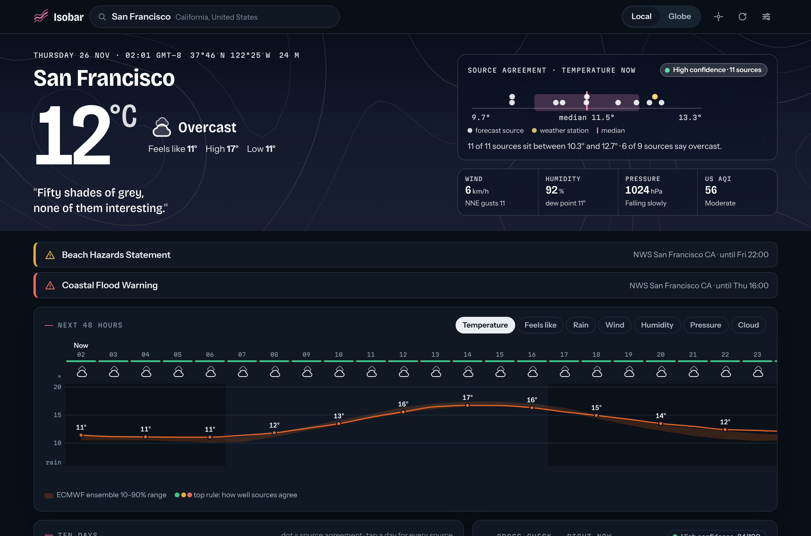
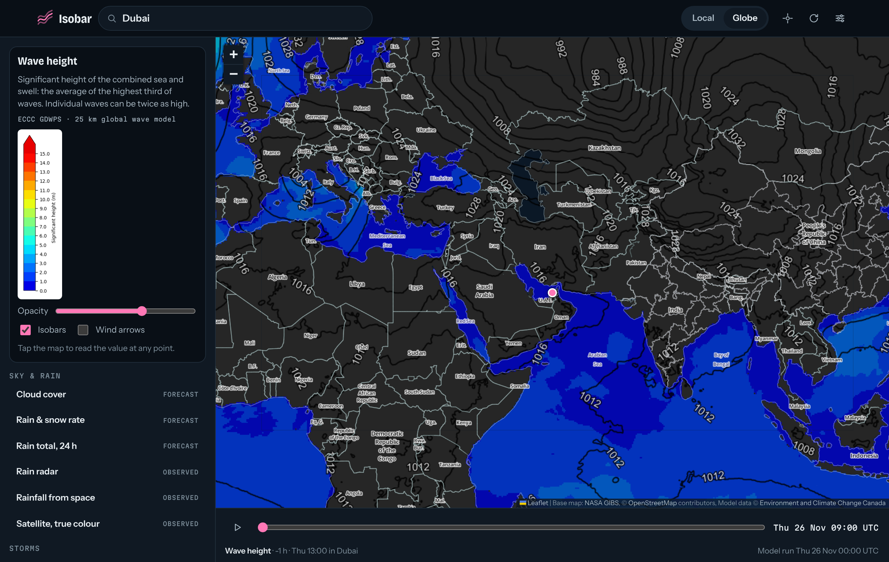

# Isobar

A weather station for the browser that asks several independent sources the
same question, shows you the median, and tells you how far to trust it.

Everything is metric: °C, km/h (or m/s), mm, hPa, km, m, µg/m³.

- **Local view** — current conditions, 48-hour and 10-day forecasts, rain in the
  next hours, wind, pressure, UV, humidity, visibility, cloud, air quality, sea
  state, tides, sun, moon, rain radar, climate context and space weather.
- **Globe view** — a world map of global-model and satellite layers (cloud,
  rain, thunderstorm probability, storm energy, wind, temperature, pressure
  with isobars, snow, sea ice, waves, swell, currents, sea temperature, soil
  moisture) with a forecast time slider and tap-to-read values.

No accounts, no API keys, no build step, no tracking.





## Run it

**Open one file.** `dist/isobar.html` is the whole app in a single file. Double-click
it. (Installing to the home screen and offline start need the hosted form below.)

**Serve the folder.** Needs Node 20 or newer, and nothing else:

```bash
npm start
```

Then open http://localhost:4173. Any static file server pointed at this folder
works equally well; so does any static host (GitHub Pages, Netlify, an S3
bucket). Over HTTPS the app can be installed and starts offline with the last
data it saw.

**Link to a place.** `?lat=25.2048&lon=55.2708&name=Dubai` opens that location.

## Where the numbers come from

| What | Sources | Coverage |
|---|---|---|
| Forecast, now and ahead | ECMWF IFS, NOAA GFS/HRRR, DWD ICON, ECCC GEM, Météo-France, UK Met Office (each separately, via Open-Meteo) · MET Norway · World Weather Online (via wttr.in) · DWD MOSMIX (via Bright Sky) · US National Weather Service | Global; NWS in the US only |
| Measured conditions | NWS stations · DWD SYNOP stations | US · Germany and neighbours |
| Forecast uncertainty | ECMWF 51-member ensemble | Global |
| Official alerts | NWS · DWD | US · Germany |
| Air quality | Copernicus CAMS Europe and CAMS global · Sensor.Community citizen sensors | Global; two models in Europe; sensors where volunteers run them |
| Waves and sea | ECMWF WAM, NOAA GFS Wave, Météo-France MFWAM, DWD GWAM · MET Norway Oceanforecast | Global; MET Norway in north-west Europe |
| Tides | NOAA CO-OPS gauge predictions · 8 km global ocean model | Gauges: US coasts and some Pacific islands; model: global |
| Sun and moon | Computed on the device (Astronomy Engine) · checked against MET Norway and Open-Meteo | Global |
| Climate context | ERA5 reanalysis, last ten years | Global |
| Space weather | NOAA SWPC planetary K index | Global |
| Radar | RainViewer mosaic | Where countries share radar |
| Globe layers | ECCC GDPS 15 km, GDWPS 25 km, GIOPS (MSC GeoMet) · NASA GIBS (VIIRS, IMERG, MODIS, MUR, SMAP) | Global |

## How confidence is worked out

For each reading (`src/lib/consensus.js`):

1. Take the **median** of the sources that answered.
2. With four or more sources, set aside any that sit far outside both the
   group's own scatter and a fixed limit for that variable (4 °C for
   temperature). Never more than a third of them: past that it is
   disagreement, not an outlier.
3. Measure the **spread** of the rest around the median.
4. Score it against fixed tolerances per variable. Temperature within ±1.0 °C
   is high, within ±2.5 °C medium, wider is low. The full table is `VARS` in
   that file.
5. Cap by count: one source is always **unverified**, two can never be high.
6. Each outlier set aside costs some confidence.

Tap any confidence chip, cross-check row or forecast day to see every source's
value.

## What it cannot tell you

- **Agreement is not proof.** Models share observations and physics and can be
  wrong together. A high rating means the sources agree, not that the sky has
  signed off.
- **Tides away from a NOAA gauge are a model estimate.** Measured against
  gauges, the ocean model's highs and lows ran 10–60 minutes off on open coasts
  and about 90 minutes off inside San Francisco Bay. The app labels these
  unverified. Do not navigate by them.
- **Air quality is often a single model.** Outside Europe only CAMS global
  (about 45 km) covers a place unless citizen sensors are nearby. It shows the
  regional background, not your street.
- **UV, visibility, currents and the 15-minute rain steps have one source** and
  are marked that way.
- **There is no global hail forecast** in any free public feed. The Globe shows
  storm energy (CAPE), hail's main ingredient, and says so.
- **Drought** is shown as soil moisture (satellite root-zone analysis and model
  topsoil forecast): the amount of water, not how unusual it is for the season.
- **Globe forecast layers are one model** (Canada's GDPS), not a blend.
- **Sea-level pressure above about 500 m** is an estimate each model makes
  differently, so its spread is wider there.

## Privacy

Settings and saved places stay in your browser's local storage. The only thing
sent out is the coordinates each weather service needs, rounded to three
decimals (about 100 m). Location access is asked for only when you press the
locate button.

## Development

```bash
npm install
```

```bash
npm test
```

```bash
npm run test:live
```

```bash
npm run build
```

- `npm test` — unit tests for the consensus maths, time zones, tide analysis,
  astronomy fixed cases and provider parsing. No network.
- `npm run test:live` — fetches every source for seven cities and checks that
  the adapters still parse real responses and that independent sources agree
  where they should (sunrise within 3 minutes of MET Norway, and so on). Behind
  an HTTP proxy, prefix with `NODE_USE_ENV_PROXY=1`.
- `npm run build` — regenerates `dist/isobar.html`.
- `npm run vendor` — refreshes `vendor/` and `assets/fonts/` from `node_modules`.

```
index.html          page shell
css/app.css         all styles, light and dark tokens
src/main.js         settings, places, routing, render loop
src/engine.js       loads every feed in parallel, derives the view
src/lib/            consensus, model, time, units, tides, astronomy, scales
src/providers/      one adapter per data service
src/ui/             panels, charts, sky, moon, maps
data/               NOAA tide-station index (3,502 stations)
vendor/             Astronomy Engine, Leaflet
```

The free services have fair-use limits. Open-Meteo allows 10,000 calls a day
per address for non-commercial use, and one page load here weighs several
dozen. Responses are cached for 10–60 minutes to stay well inside that. For a
public or commercial deployment, read each provider's terms first.

## Credits and licences

Weather data by [Open-Meteo](https://open-meteo.com) (CC BY 4.0), with models
from ECMWF, NOAA, DWD, ECCC, Météo-France and the UK Met Office;
[MET Norway](https://api.met.no) (CC BY 4.0 / NLOD); the US National Weather
Service and NOAA CO-OPS and SWPC (public domain); DWD via
[Bright Sky](https://brightsky.dev); World Weather Online via
[wttr.in](https://wttr.in); Copernicus Atmosphere Monitoring Service;
[Sensor.Community](https://sensor.community) (ODbL);
[RainViewer](https://www.rainviewer.com); Environment and Climate Change Canada
(MSC GeoMet); NASA EOSDIS GIBS; OpenStreetMap contributors; BigDataCloud for
reverse geocoding.

Bundled: [Astronomy Engine](https://github.com/cosinekitty/astronomy) (MIT),
[Leaflet](https://leafletjs.com) (BSD-2-Clause), and the fonts Bricolage
Grotesque, Instrument Sans and Martian Mono (SIL Open Font License 1.1; see
`assets/fonts/LICENSES.txt`).

Isobar is not a safety service. For warnings, follow your national weather
agency.
